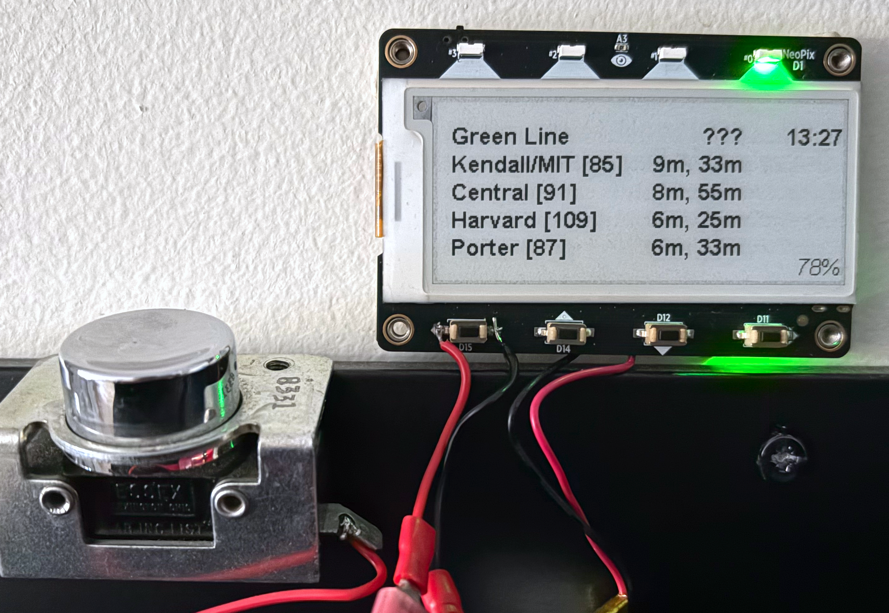
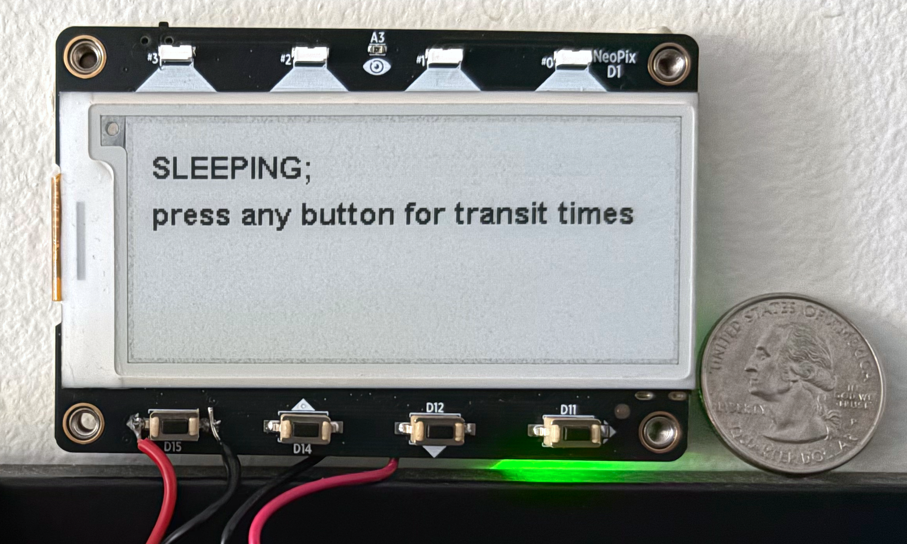

I live at the nexus of a bunch of public transit routes, so I built a little on-demand display:

It's pretty basic: an [Adafruit MagTag](https://www.adafruit.com/product/4800) powered by a little [LiPo battery](https://www.adafruit.com/product/1570), plus a pleasing---albeit un-necessary!---button picked up at [Swapfest](https://w1mx.mit.edu/flea-at-mit/).[^swapfest]

[^swapfest]: This leaves me with only one gazillion _minus one_ items from Swapfest awaiting a project. Progress!

When the Big Button™---or any of the on-board buttons---is pushed, the board wakes up, connects to WiFi, requests the next per-route departures from the [MBTA](https://en.wikipedia.org/wiki/Massachusetts_Bay_Transportation_Authority)'s API, and displays them. Every 30 seconds thereafter it refreshes those times; and after several minutes displays a "sleeping" screen and hibernates. If a button is re-pressed any time during the wake period, additional refreshes are added pre-hibernation.

The initial wake-up isn't instantaneous, but that hasn't been a problem: waiting 18 seconds for it to wake up is still better than pulling out a phone, spending that same 18 seconds searching for the same info and inevitably getting distracted into doing More Phone Things. It's certainly enough time to put on shoes while waiting to find out if the next expected bus is on time (run!!) or a few minutes delayed (saunter!). Although sometimes the MBTA's API returns upcoming departures without scheduled times, so the best we can see is "???" to show that _something_ will depart _some time_.[^terminus]

[^terminus]: To be fair, I have yet to see this for a bus---just for my favorite local Green Line terminus... That said, even when that terminus shows a real time on the platform's displays, the conductors don't always pay attention. "3m until departure" says the announcement and the display, to the dismay of those of us left in the wake of the departing train.

<iframe
    width="560"
    height="315"
    src="https://www.youtube-nocookie.com/embed/AsXHbMu94-c?si=Vjum8xVbuWTjihGe"
    title="YouTube video player"
    frameborder="0"
    allow="accelerometer; autoplay; clipboard-write; encrypted-media; gyroscope; picture-in-picture; web-share"
    referrerpolicy="strict-origin-when-cross-origin"
    allowfullscreen
></iframe>

I chose an Adafruit MagTag for this project because I wanted to make something functional quickly and relatively cheaply, without faffing about with too many components: the MagTag has WiFi, display, and buttons all built in.[^excuse] The display is E-Ink so doesn't draw power except when the screen is actively updating, which is great---with our current usage patterns of the transit display, we only need to recharge its LiPo battery once every few weeks.[^needs] The recharge is trivially easy with a portable USB battery pack.

[^excuse]: Okay, okay, I *also* chose it because I wanted an excuse to play with a MagTag!

[^needs]: We decided we didn't need an always-on-and-always-updating display because most of the time we simply don't care about the next departure times! An on-demand-(with-short-term-updating) display better meets our needs anyway.

***

My code is [here](https://github.com/hannahilea/notebook-playground/tree/main/magtag-mbta-display). To set up your own:

- *If you're Boston-based (i.e., also use the MBTA):* Follow the set-up instructions in the README, which will walk you through configuring the MagTag to connect to your WiFi and setting up your own list of MBTA routes.[^lucky]

[^lucky]: Of course, if you live in the middle of Union Square, Somerville, you're in luck---that's set of stops I selected for the demo and the default routes in the code.

- *If you don't live in Boston:* Sorry, slightly more work for you! You can still start from that code, but you'll almost certainly need to adapt it. Once you've found your local transit's API, you'll likely need to update the JSON-parsing piece of my `code.py` script for your API's response format.[^leads]

[^leads]: One possible breadcrumb for transit APIs is the [Transit](https://transitapp.com/en/region) app's [API](https://api-doc.transitapp.com/v4.html#description/introduction), although I haven't poked at it myself. My assumption is that if a transit organization is available via Transit, it has _some_ API of its own.

***Thanks to Alex for photography and the MBTA for the API.***
